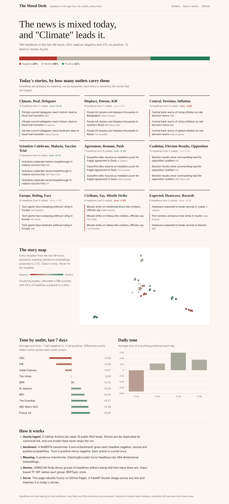
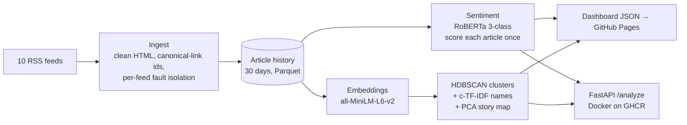

# The Mood Desk: live news sentiment and story discovery with transformers

[](https://github.com/PalakGupta7456/news-sentiment-engine/actions/workflows/ci.yml)
[](https://github.com/PalakGupta7456/news-sentiment-engine/actions/workflows/pipeline.yml)
 

**Live dashboard: https://palakgupta7456.github.io/news-sentiment-engine/**

An NLP system that runs every hour. It reads world headlines from 10 international outlets, scores their tone with a **RoBERTa transformer**, and groups them into stories using **sentence embeddings, HDBSCAN and class-based TF-IDF** (the approach behind BERTopic). It then publishes an interactive dashboard and ships a **FastAPI** service in Docker.



## What it shows
- **The day's mood.** The overall tone (positive minus negative probability) and the negative / neutral / positive mix.
- **Stories by reach.** Clusters ranked by how many *different outlets* carry them, named automatically.
- **Story map.** Every headline placed by meaning (a 2-D projection of its embedding) and coloured by tone.
- **Outlet comparison.** The 7-day average tone per outlet. Differences partly reflect story selection, not only framing.

## Architecture



## Design choices worth discussing

| Decision | Why |
|---|---|
| **Score each article once** | New articles are found with stable ids (canonical link with tracking parameters stripped). Only unscored rows go through the transformer, so hourly cost stays flat. If the model changes, anything without a score is re-scored automatically. |
| **HDBSCAN, not k-means** | The number of stories changes every day. HDBSCAN finds dense groups without a preset *k*, and leaves one-off headlines as noise instead of forcing them into a topic. |
| **c-TF-IDF names** | Treating each cluster as one document gives TF-IDF weights that favour words frequent *in this story* but rare in the others. Overlapping n-grams are de-duplicated ("gaza" is dropped when "gaza ceasefire" is kept). |
| **Pluggable models** | `models.py` defines small interfaces. Unit tests run with a lexicon model and a hashing encoder in about 2 seconds with no downloads. A separate CI job loads the real Hugging Face models and checks their outputs make sense (a disaster headline must be negative; related headlines must embed closer than unrelated ones). |
| **Fault isolation** | One feed timing out or changing format is logged in the run report and does not stop the pipeline. |
| **Models baked into the image** | The Docker build downloads both models, so the container starts offline and quickly. |

**Quality metrics** shown on the dashboard: the silhouette score (cosine) of the clusters, and coverage (the share of headlines assigned to a story).

## API

```bash
docker run -p 8000:8000 ghcr.io/palakgupta7456/news-sentiment-engine
curl -X POST localhost:8000/analyze -H 'content-type: application/json' \
     -d '{"text": "Central bank holds rates as inflation cools"}'
# → {"label": "neutral", "tone": 0.12, "probabilities": {...}, "closest_story": {"name": "...", "similarity": 0.71}}
```

## CI/CD

| Workflow | What it does |
|---|---|
| `ci.yml` | ruff lint; pytest with lightweight models (feed parsing, de-duplication, topic recovery on planted stories, idempotent re-runs, API); transformer smoke test with the real models; Docker build, then a `/analyze` smoke test, then a push to GHCR |
| `pipeline.yml` | hourly cron: Hugging Face model cache, then ingest, score, cluster and publish; history saved on the `live-data` branch; GitHub Pages deploy |

## Run locally

```bash
pip install torch --index-url https://download.pytorch.org/whl/cpu
pip install -e ".[ml,api,dev]"
python -m newsmood.pipeline                         # live feeds with real models
python -m newsmood.pipeline --lightweight --synthetic   # offline, no downloads
python -m http.server -d docs 8080
pytest
```

## Limitations
- The sentiment model was fine-tuned on social-media text. Headlines are short, factual and often about bad events, so "negative" frequently means *a negative event*, not *negative framing*. A news-specific fine-tune (for example on a hand-labelled sample) would be the next improvement.
- RSS gives headlines and summaries only, not full articles.
